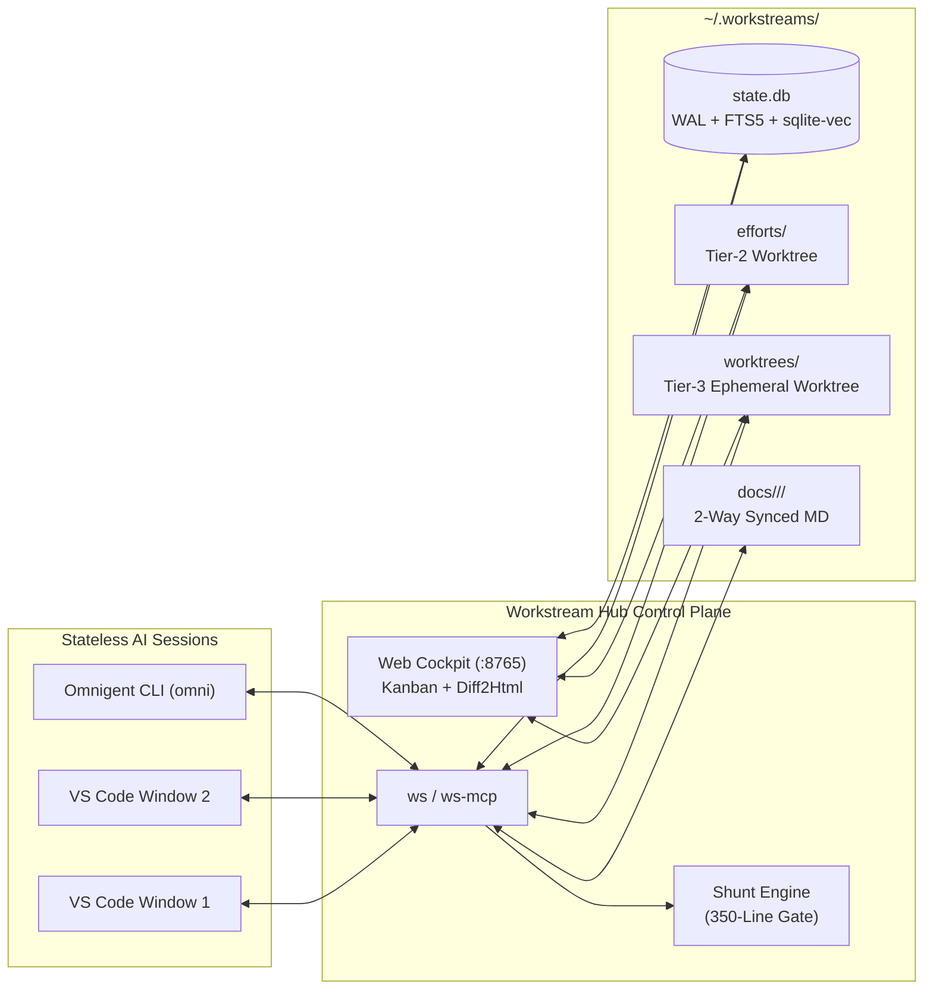

# ⚡ Workstream Hub (`workstream-hub`)

**Local Multi-Session AI Orchestration, Context-Shunting & Hybrid-RAG Memory Hub for macOS**

Workstream Hub (`~/.workstreams`) is a deterministic local control plane that coordinates parallel **VS Code Copilot Chat** windows, **Cursor / Antigravity** sessions, and **Databricks Omnigent (`omni`)** CLI sub-agents across multiple Git repositories—without polluting your codebases or bloating your LLM context windows.

---

## 📚 Documentation Index

| Document | Audience | Contents |
| :--- | :--- | :--- |
| **[Usage & How-To Guide (`docs/USAGE_GUIDE.md`)](docs/USAGE_GUIDE.md)** | Developers & AI Agents | Step-by-step workflows, `/ws-*` slash prompts, multi-window handoffs, Shunt examples, Web Cockpit guide, and FAQ. |
| **[Architecture & Engineering Spec (`docs/ARCHITECTURE.md`)](docs/ARCHITECTURE.md)** | Systems Engineers | SQLite WAL fencing tokens, Hybrid RAG RRF math, 2-tier Git worktrees, `git merge-tree` conflict radar, `tree-sitter` AST extraction, and Shunt internals. |
| **[Master Spec & Execution Plan (`workstream_hub_master_spec_execution_plan.md`)](workstream_hub_master_spec_execution_plan.md)** | Maintainers & Agents | Original system specification, exact SQLite DDL, and acceptance criteria (`AC-1` – `AC-8`). |

---

## 🚀 Quick Start & AI Agent Installation Runbook (macOS)

Whether you are a developer or an autonomous AI agent installing this repository on a Mac, run these steps in order:

### 1. Verify Prerequisites
Requires macOS (Apple Silicon / Intel), `git` 2.38+, and `uv`:
```bash
export PATH="$HOME/.local/bin:/opt/homebrew/bin:/usr/local/bin:$PATH"
git --version
uv --version || curl -LsSf https://astral.sh/uv/install.sh | sh
```

### 2. Run the 1-Command Installer
```bash
make install
```
**What `make install` (`./scripts/install_macos.sh`) sets up automatically:**
1. Installs global executables (`ws`, `ws-mcp`, `ws-ui`) into `~/.local/bin` via `uv tool install --force --editable .`.
2. Installs the 350-line pre-read interceptor hook at `~/.workstreams/bin/check_file_size_hook.py`.
3. Runs `ws init --warm-embedder` to initialize `~/.workstreams/state.db` (SQLite WAL + `FTS5` + `sqlite-vec`) and pre-warm the local `BAAI/bge-small-en-v1.5` 384-dim ONNX model.
4. Symlinks the `workstream-protocol` and `spec-griller` skills into `~/.copilot/skills/` and `~/.omnigent/skills/`.
5. Copies `shunt_policy.yaml` into `~/.omnigent/policies/shunt_policy.yaml`.
6. Symlinks `/ws-hydrate`, `/ws-move`, `/ws-grill`, and `/ws-finalize` prompts into `~/Library/Application Support/Code/User/prompts/`.
7. Loads `~/Library/LaunchAgents/com.workstreams.ui.plist` so the **Unified Web Cockpit** runs automatically in the background at **http://localhost:8765**.

### 3. Connect `ws-mcp` to Your IDE
Add `workstream-hub` to your VS Code MCP configuration (`~/Library/Application Support/Code/User/mcp.json`):
```json
{
  "servers": {
    "workstream-hub": {
      "type": "stdio",
      "command": "ws-mcp",
      "env": {
        "SHUNT_MIN_LINES": "350"
      }
    }
  }
}
```
*(If your IDE does not inherit `~/.local/bin` on `PATH`, set `"command": "/Users/<your-username>/.local/bin/ws-mcp"`).*

### 4. Verify Installation & Run Acceptance Suite
```bash
which ws ws-mcp ws-ui
make test
curl -s http://127.0.0.1:8765/api/status
```

---

## 🏗️ System Highlights



1. **Strict Decoupling of Memory & Code:** Specs (`SPEC.md`), ADRs (`DECISIONS.md`), sibling rollups (`SIBLING_ROLLUP.md`), checkpoints, and vectors live in `~/.workstreams/`, never polluting source repositories.
2. **Fixed 3-Tier Hierarchy with Sibling Inheritance:**
   - **Tier 1 (`Workstream`):** Multi-repo Epic.
   - **Tier 2 (`Effort`):** 1 Repo + 1 Persistent Integration Worktree (`~/.workstreams/efforts/<effort_id>`).
   - **Tier 3 (`Sub-Effort`):** 1 Ephemeral POC Worktree (`~/.workstreams/worktrees/<sub_id>`) that auto-prunes on finalization while rolling up its conclusions, metrics, Git SHA, and `tree-sitter` AST symbols into the parent Effort's `SIBLING_ROLLUP.md`.
3. **Stateless Windows + Monotonic Fencing Tokens:** `BEGIN IMMEDIATE` SQLite locks with 60-minute sliding TTLs prevent split-brain writes across chat windows (`LeaseFencingError`).
4. **Dual-Tier Hybrid RAG (Reciprocal Rank Fusion):** Combines SQLite `FTS5` (BM25) + `sqlite-vec` (`BAAI/bge-small-en-v1.5` 384-dim embeddings) + two-way `mtime` disk sync + optional `paparats-mcp` (`:9876`) call-graph integration.
5. **The Local "Shunt" Context-Protection Layer:** Blocks un-ranged full-file reads `> 350 lines` and provides `ws_shunt_read` (`< 250 token` out-of-band bullet summaries with `file:start-end` citations) and `ws_shunt_write` (convention-mirroring out-of-band boilerplate/test writer).
6. **Unified Web Cockpit (`http://localhost:8765`):** FastAPI + HTMX + Tailwind + Diff2Html dashboard with 3-tier Kanban swimlanes, Shunt token-savings telemetry, `git merge-tree` conflict radar, and side-by-side branch diffs (even after Tier-3 worktrees are pruned).

---

## 🛠️ CLI (`ws`) & MCP (`ws-mcp`) Quick Reference

| CLI Command | MCP Tool Name | Description |
| :--- | :--- | :--- |
| `ws init` | *(CLI only)* | Creates `~/.workstreams/` dirs, initializes `state.db`, and warms `fastembed`. |
| `ws create-ws` | `ws_create_workstream` | Creates Tier-1 Workstream + `WORKSTREAM_OVERVIEW.md`. |
| `ws create-effort` | `ws_create_effort` | Creates Tier-2 Effort + persistent worktree at `~/.workstreams/efforts/<id>`. |
| `ws create-sub` | `ws_create_sub_effort` | Creates Tier-3 Sub-Effort + ephemeral worktree at `~/.workstreams/worktrees/<id>`. |
| `ws hydrate` | `ws_hydrate` | Syncs disk `mtime`, acquires fencing `lease_token`, checks sibling conflicts, returns `<500 token` hydration payload. |
| `ws checkpoint` | `ws_checkpoint` | Saves `<300 token` stateless checkpoint and optionally releases lease. |
| `ws save-spec` | `ws_save_spec` | Saves `SPEC.md`, chunks by headings, and indexes into `FTS5` + `sqlite-vec`. |
| `ws log-decision` | `ws_log_decision` | Appends ADR to `DECISIONS.md` + DB and indexes into Hybrid RAG. |
| `ws finalize` | `ws_finalize` | Verifies clean tree, extracts `tree-sitter` AST diff, updates parent `SIBLING_ROLLUP.md`, merges to Effort branch, and auto-prunes Tier-3 worktree. |
| `ws reopen` | `ws_reopen_worktree` | Re-materializes a pruned Tier-3 worktree from branch `ws/<sub_id>`. |
| `ws search` | `ws_rag_search` | Runs Hybrid RRF search (`sqlite-vec` + `FTS5`) across Specs, ADRs, Rollups, Conclusions, and AST snippets. |
| `ws check-file` | `ws_check_file_gate` | Enforces the `SHUNT_MIN_LINES=350` hard gate. |
| `ws shunt-read` | `ws_shunt_read` | Out-of-band `bulk-reader` returning `<250 token` citations/summaries. |
| `ws shunt-write` | `ws_shunt_write` | Out-of-band `code-writer` writing directly to worktree disk modeled after `--reference`. |
| `ws delegate` | `ws_delegate_omni` | Acquires lease for `omni-cli` and delegates task to Databricks Omnigent. |

---

## 📂 Repository Structure

```text
workstream-hub/
├── README.md                            # Quick start, AI agent runbook & overview
├── Makefile                             # 1-command installer (`make install`) & test runner (`make test`)
├── pyproject.toml                       # Package definition (`ws`, `ws-mcp`, `ws-ui`)
├── docs/
│   ├── USAGE_GUIDE.md                   # End-to-end user & AI agent how-to guide
│   └── ARCHITECTURE.md                  # Deep-dive systems engineering & architecture doc
├── scripts/
│   ├── install_macos.sh                 # Sets up ~/.workstreams, symlinks skills/prompts, LaunchAgent
│   ├── check_file_size_hook.py          # Pre-read interceptor enforcing SHUNT_MIN_LINES (350 lines)
│   └── com.workstreams.ui.plist         # macOS LaunchAgent for localhost:8765 background UI
├── assets/
│   ├── skills/                          # workstream-protocol & spec-griller SKILL.md files
│   ├── prompts/                         # VS Code /ws-hydrate, /ws-move, /ws-grill, /ws-finalize prompts
│   ├── omnigent/shunt_policy.yaml       # Omnigent policy gating >350 line reads
│   └── paparats/docker-compose.yml      # Optional paparats-mcp (:9876) + Qdrant stack
├── src/workstream_hub/                  # Core Python package (SQLite WAL, RAG, Worktrees, Shunt, CLI/MCP, UI)
└── tests/                               # Deterministic pytest suite verifying AC-1 through AC-8
```
