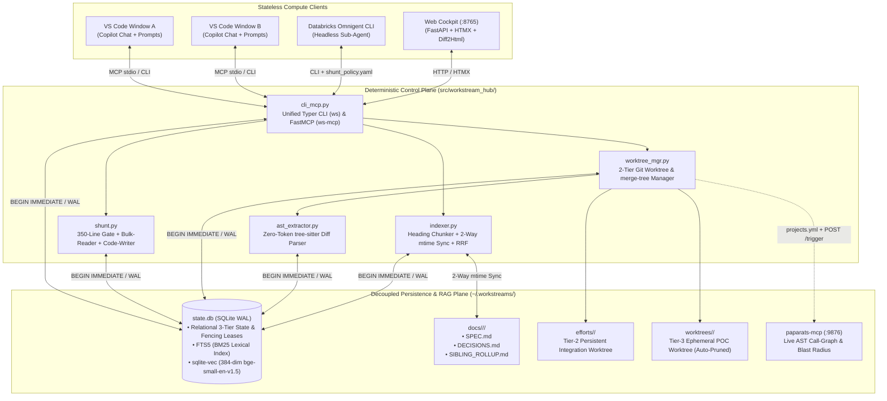
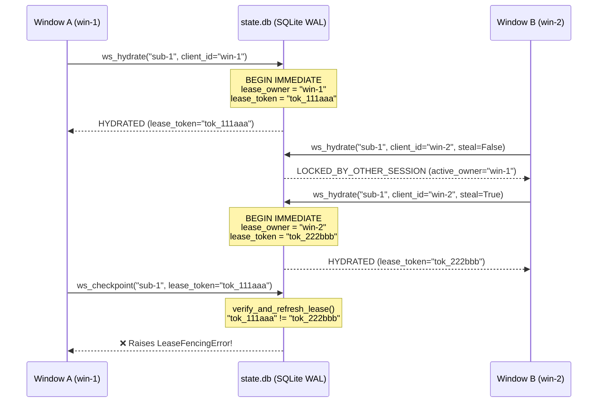
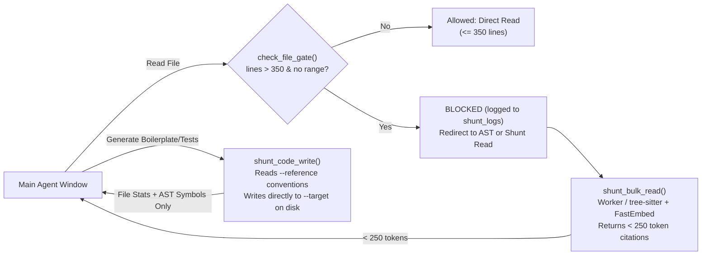
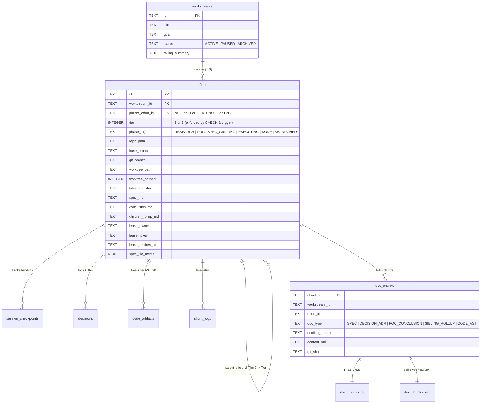

# Workstream Hub — Systems Engineering & Architecture Specification

This document details the internal systems design, concurrency invariants, retrieval algorithms, and Git worktree mechanics of **Workstream Hub (`workstream-hub`)**.

---

## 1. High-Level System Architecture

Workstream Hub operates as a **local, single-node distributed coordination and memory plane** (`~/.workstreams/`) sitting beneath multiple concurrent AI coding clients (**VS Code Copilot Chat** windows, **Cursor / Antigravity** sessions, and headless **Databricks Omnigent (`omni`)** sub-agents).



---

## 2. Core Engineering Principles

### 2.1 Strict Decoupling of Memory and Source Code
AI agents frequently pollute application repositories with scratch markdown files, half-baked design specs, or uncommitted notes. Workstream Hub enforces a **zero-footprint policy** inside source repositories:
- Source repositories are referenced solely via `repo_path`, `worktree_path`, `git_branch`, and `git_sha`.
- All specifications (`SPEC.md`), Architectural Decision Records (`DECISIONS.md`), sibling conclusions (`SIBLING_ROLLUP.md`), session checkpoints, and vector embeddings reside exclusively inside `~/.workstreams/`.
- Even the active session lockfile (`.ws_lock.json`) written into a worktree is automatically injected into `<gitdir>/info/exclude` (never modifying the repository's committed `.gitignore`).

### 2.2 Fixed 3-Tier Hierarchy & Bottom-Up Sibling Rollup
Unbounded task trees cause context fragmentation. Workstream Hub constrains orchestration to a strict **3-tier tree** enforced at both the Python domain layer and the SQLite storage engine (`CHECK` constraints + `BEFORE INSERT` triggers):

1. **Tier 1 (`Workstream`):** Multi-repository Epic (`workstreams` table).
2. **Tier 2 (`Effort`):** Feature branch (`ws/<effort_id>`) checked out into a **persistent integration worktree** at `~/.workstreams/efforts/<effort_id>`.
3. **Tier 3 (`Sub-Effort`):** Atomic POC or implementation slice (`ws/<sub_id>`) branched off `ws/<effort_id>` into an **ephemeral worktree** at `~/.workstreams/worktrees/<sub_id>`.

#### The Sibling Inheritance Loop
When a Tier-3 `Sub-Effort` (`sub-1`) is finalized via `ws_finalize`:
1. Its structured conclusion, Git SHA, and `tree-sitter`-extracted AST symbols are compiled into a Markdown rollup block.
2. This block is atomically appended to the parent Tier-2 Effort's `children_rollup_md` column and mirrored to `~/.workstreams/docs/<ws_id>/<effort_id>/SIBLING_ROLLUP.md`.
3. When a subsequent sibling (`sub-2`) calls `ws_hydrate`, it automatically inherits `parent.children_rollup_md`—including conclusions from both merged and **abandoned/rejected POCs**—preventing sibling sessions from repeating failed experiments.

---

## 3. Stateless Windows & Monotonic Fencing Tokens (`db.py`)

### 3.1 The Split-Brain Problem in Multi-Window IDE Workflows
When a developer opens multiple VS Code windows on the same task—or moves a task from a bloated chat window to a fresh window—an older window may still have an active LLM turn or stale tool call in flight. Simple boolean locks fail if a lock expires or is stolen while the old client is mid-execution.

### 3.2 Monotonic Fencing Token Protocol
Workstream Hub implements **Kleppmann-style Fencing Tokens** backed by SQLite `WAL` mode and `BEGIN IMMEDIATE` transactions:



1. **Serialized Lease Acquisition (`acquire_lease`):**
   - Executes `BEGIN IMMEDIATE` on `state.db`, acquiring a reserved write lock immediately and serializing concurrent callers.
   - Evaluates `lease_owner IS NOT NULL AND lease_expires_at > datetime('now')`.
   - If locked by another client and `steal=False`, rolls back and returns `LOCKED_BY_OTHER_SESSION`.
   - Otherwise, generates a fresh token `tok_<10-hex-chars>`, sets a 60-minute sliding TTL (`datetime('now', '+60 minutes')`), and writes `.ws_lock.json` to the worktree.
2. **Write Verification (`verify_and_refresh_lease`):**
   - Every mutating operation (`ws_checkpoint`, `ws_save_spec`, `ws_log_decision`, `ws_finalize`, `ws_shunt_write`) validates `efforts.lease_token == lease_token` inside an immediate transaction.
   - Mismatched or expired tokens raise `LeaseFencingError` before any disk or database mutation can occur.
   - Valid tokens slide the expiration window forward by `+60 minutes`.

---

## 4. Dual-Tier Hybrid RAG & Reciprocal Rank Fusion (`indexer.py`)

Workstream Hub combines two complementary retrieval engines:
- **Engine 1 (`state.db`):** Indexes ephemeral design docs (`SPEC.md`), ADRs (`DECISIONS.md`), sibling rollups (`SIBLING_ROLLUP.md`), POC conclusions (including pruned/unmerged branches), and diff AST signatures (`CODE_AST`).
- **Engine 2 (`paparats-mcp` on `:9876`):** Indexes full canonical repositories and Tier-2 integration worktrees for call-graph blast-radius (`change_impact`, `find_usages`).

### 4.1 Heading-Aware Chunking with Lineage Injection
Standard fixed-token sliding windows sever markdown headings from their bodies, degrading retrieval accuracy. [`chunk_markdown_by_headers`](../src/workstream_hub/indexer.py) splits documents on `^#{1,3}\s+(.+)$` and prepends a deterministic lineage header to every chunk prior to both BM25 tokenization and ONNX vector embedding:

```text
[Workstream: ws-payments | Effort: eff-webhook | Type: SPEC | Section: Retry Backoff Policy]
<section markdown body>
```

### 4.2 Reciprocal Rank Fusion (RRF) Scoring
Pure vector search struggles with exact identifier names (e.g., `compute_sparse_hash`, error codes, config keys), while pure BM25 keyword search misses conceptual synonyms.

[`hybrid_search`](../src/workstream_hub/indexer.py) queries both virtual tables in parallel:
1. **Semantic Vector Search (`doc_chunks_vec`):** Uses `sqlite-vec` (`vec0` virtual table) with 384-dimensional float32 embeddings generated locally via `fastembed` (`BAAI/bge-small-en-v1.5`) to obtain $\text{rank}_{\text{vec}}(d) \in \{1, \dots, 20\}$.
2. **Lexical BM25 Search (`doc_chunks_fts`):** Uses SQLite `FTS5` with Porter stemming (`tokenize = 'porter unicode61'`) ordered by `bm25(doc_chunks_fts)` to obtain $\text{rank}_{\text{fts}}(d) \in \{1, \dots, 20\}$.
3. **RRF Aggregation ($k = 60$):**
   $$\text{RRF\_Score}(d) = \frac{1}{60 + \text{rank}_{\text{vec}}(d)} + \frac{1}{60 + \text{rank}_{\text{fts}}(d)}$$
   Chunks matching in both lexical and semantic space bubble deterministically to the top without requiring brittle score normalization between cosine distances and unbounded BM25 weights.

### 4.3 Two-Way `mtime` Disk Mirroring
Every call to `ws_hydrate` or `ws_rag_search` executes [`sync_docs_from_disk`](../src/workstream_hub/indexer.py):
- Compares `os.path.getmtime(SPEC.md)` (and content hash/equality) against `efforts.spec_file_mtime` in `state.db`.
- If a human edited `~/.workstreams/docs/<ws_id>/<effort_id>/SPEC.md` in VS Code, the updated file is automatically ingested into `efforts.spec_md` and re-chunked/re-embedded in `doc_chunks`, `doc_chunks_fts`, and `doc_chunks_vec`.

---

## 5. Two-Tier Worktree Lifecycle & Zero-Token AST Extraction

### 5.1 Zero-Token Diff AST Extractor (`ast_extractor.py`)
When a Sub-Effort is finalized, we want future sessions to be able to search the exact functions, classes, structs, and traits created or modified in that POC—**without spending LLM tokens** to summarize the code and **without keeping the ephemeral worktree on disk**.

[`extract_and_index_git_diff_ast`](../src/workstream_hub/ast_extractor.py):
1. Runs `git -C <worktree_path> diff --name-only ws/<parent_effort_id>..HEAD`.
2. Parses each modified file using `tree-sitter-language-pack` (supporting Python, Rust, Scala, SQL, TypeScript, JavaScript, Go, and Java).
3. Traverses the syntax tree for top-level `function_definition`, `class_definition`, `function_item`, `struct_item`, `trait_item`, and `impl_item` nodes (unwrapping decorators and export statements).
4. Truncates function/class bodies exceeding 50 lines while preserving signatures and docstrings.
5. Persists extracted records into `code_artifacts` and indexes them into Hybrid RAG under `doc_type = 'CODE_AST'`.

### 5.2 Auto-Pruning vs. Persistent Git Refs (`worktree_mgr.py`)
Leaving dozens of POC worktrees checked out on disk wastes gigabytes of storage and confuses IDE file watchers. Upon [`finalize_sub_effort`](../src/workstream_hub/worktree_mgr.py):
1. **Dirty-Tree Guard:** Runs `git status --porcelain` (ignoring `.ws_lock.json`). Any uncommitted file aborts finalization with `DirtyWorktreeError`.
2. **Integration Merge:** If `merge_to_effort=True`, merges `ws/<sub_id>` (`--no-ff`) into `~/.workstreams/efforts/<parent_id>` and triggers `POST http://localhost:9876/trigger` so Paparats updates its call graph.
3. **Physical Directory Prune, Logical Ref Retention:** Executes `git worktree remove ~/.workstreams/worktrees/<sub_id> --force` and sets `worktree_pruned = 1, worktree_path = NULL`. Critically, the Git branch ref `refs/heads/ws/<sub_id>` is **retained** in the canonical repo's object database:
   - The Web Cockpit can still render side-by-side diffs (`git diff ws/<parent_id>..ws/<sub_id>`) at any time.
   - Calling `ws reopen <sub_id>` can re-materialize the worktree on disk in milliseconds.

### 5.3 Non-Mutating Sibling Conflict Radar (`git merge-tree`)
Traditional conflict checks require `git merge --no-commit --no-ff` followed by `git merge --abort`, which mutates the working tree and fails if a developer is actively editing files.

[`check_sibling_conflicts`](../src/workstream_hub/worktree_mgr.py) uses Git 2.38+'s in-memory tree merge:
```bash
git -C <repo_path> merge-tree --write-tree ws/<sub_a> ws/<sub_b>
```
This computes the 3-way merge completely inside Git's object store with **zero working-tree mutation**, returning `{"has_conflict": bool, "conflicting_files": list[str], "conflict_pairs": [...]}` for every pair of active sibling branches.

---

## 6. The Local "Shunt" Context-Protection Layer (`shunt.py`)

Inspired by Spotify's context-shunting pattern, [`shunt.py`](../src/workstream_hub/shunt.py) prevents the primary orchestrator window from suffering context degradation:



1. **The 350-Line Hard Gate (`check_file_gate` & `scripts/check_file_size_hook.py`):**
   - Intercepts un-ranged file reads exceeding `SHUNT_MIN_LINES` (`350`).
   - Logs a `GATE_BLOCKED` event in `shunt_logs` and returns a directive instructing the agent to use `paparats-mcp` AST search, explicit `offset`/`limit` ranges, or `ws_shunt_read`.
2. **Out-of-Band Bulk Reader (`shunt_bulk_read`):**
   - Processes 1+ large files out-of-band.
   - Supports both an external fast worker CLI (`SHUNT_WORKER_CMD` at `temperature=0.2`) and a **Zero-LLM Deterministic AST + FastEmbed Ranker** that extracts all AST symbols/windows from the target files, ranks them against the agent's `question`, and returns the top-5 signatures with exact `file:start_line-end_line` citations in `< 250 tokens`.
   - Computes and logs `estimated_tokens_saved = max(0, total_lines * 8 - response_tokens)`.
3. **Out-of-Band Code Writer (`shunt_code_write`):**
   - Validates the active `lease_token`, inspects `--reference` to mirror imports and style conventions, writes the target file directly inside the Effort/Sub-Effort worktree, parses the resulting file with `tree-sitter`, and returns only `{"status": "WRITTEN", "lines_written": N, "ast_symbols_created": [...]}` to the main window.

---

## 7. Database Schema & Entity-Relationship Diagram (`state.db`)



---

## 8. Verification & Acceptance Test Matrix

All architectural invariants are continuously verified by the deterministic `pytest` suite (`uv run pytest -v`):

| Acceptance Criterion | Test File | Architectural Invariant Verified |
| :--- | :--- | :--- |
| **AC-1** | [`tests/test_leasing_concurrency.py`](../tests/test_leasing_concurrency.py) | `BEGIN IMMEDIATE` mutual exclusion, `--steal` token rotation, and `LeaseFencingError` rejection of stale tokens. |
| **AC-2** | [`tests/test_hierarchy_and_rollup.py`](../tests/test_hierarchy_and_rollup.py) | Fixed 3-tier constraint (rejects Tier-4 children at both API and SQL trigger levels) & bottom-up `children_rollup_md` sibling inheritance. |
| **AC-3** | [`tests/test_hybrid_rag_and_sync.py`](../tests/test_hybrid_rag_and_sync.py) | Heading-aware chunking, `FTS5` + `sqlite-vec` RRF retrieval, and automatic two-way `mtime` disk sync when `SPEC.md` is edited on disk. |
| **AC-4** | [`tests/test_worktree_lifecycle.py`](../tests/test_worktree_lifecycle.py) | Tier-2/Tier-3 worktree creation, `tree-sitter` extraction of `compute_sparse_hash`, `--no-ff` merge, and Tier-3 directory auto-pruning with intact Git ref. |
| **AC-5** | [`tests/test_worktree_lifecycle.py`](../tests/test_worktree_lifecycle.py) | Dirty worktree protection (`DirtyWorktreeError` aborts finalization/pruning when uncommitted files exist). |
| **AC-6** | [`tests/test_worktree_lifecycle.py`](../tests/test_worktree_lifecycle.py) | Zero-mutation sibling conflict detection via `git merge-tree --write-tree`. |
| **AC-7** | [`tests/test_worktree_lifecycle.py`](../tests/test_worktree_lifecycle.py) | `ws` CLI, `ws-mcp` tools, `projects.yml` generation, and FastAPI Web Cockpit (`GET /`, `/ui/search`, and pruned-branch `/ui/drawer/sub-1` Diff2Html rendering). |
| **AC-8** | [`tests/test_shunt_engine.py`](../tests/test_shunt_engine.py) | `SHUNT_MIN_LINES=350` hard gate, `check_file_size_hook.py` exit codes, `<250 token` `ws_shunt_read`, convention-mirroring `ws_shunt_write`, and `shunt_logs` telemetry. |
