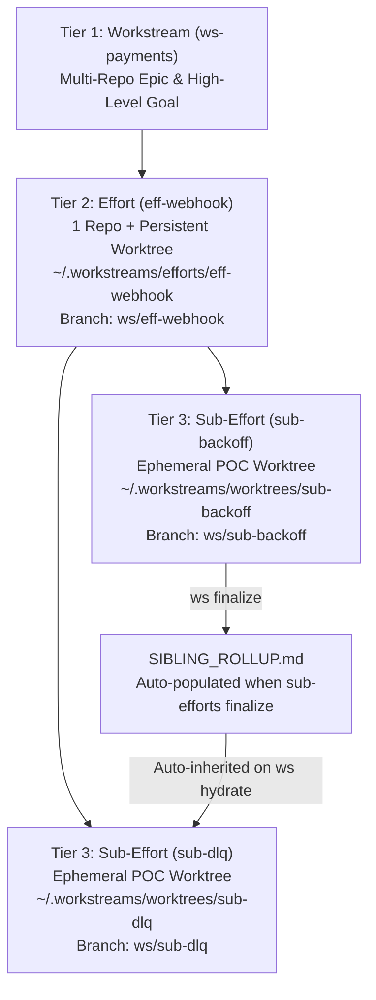

# Workstream Hub — Complete Usage & How-To Guide

This guide walks you through installing, configuring, and operating **Workstream Hub (`workstream-hub`)** for daily multi-window AI development across **VS Code Copilot Chat**, **Cursor / Antigravity**, and **Databricks Omnigent (`omni`)**.

---

## Table of Contents

1. [Mental Model: The 3-Tier Hierarchy](#1-mental-model-the-3-tier-hierarchy)
2. [Installation & IDE Setup (Human & AI Agent Runbook)](#2-installation--ide-setup-human--ai-agent-runbook)
3. [End-to-End Walkthrough: From Epic to Merged Feature](#3-end-to-end-walkthrough-from-epic-to-merged-feature)
4. [VS Code Slash Prompts (`/ws-*`)](#4-vs-code-slash-prompts-ws-)
5. [Multi-Window Handoffs & Lease Stealing](#5-multi-window-handoffs--lease-stealing)
6. [Using the Local Shunt Engine (Saving 80–94% Context Tokens)](#6-using-the-local-shunt-engine-saving-8094-context-tokens)
7. [Two-Way Markdown Editing (`SPEC.md` & `DECISIONS.md`)](#7-two-way-markdown-editing-specmd--decisionsmd)
8. [Using the Unified Web Cockpit (`http://localhost:8765`)](#8-using-the-unified-web-cockpit-httplocalhost8765)
9. [Complete CLI (`ws`) & MCP (`ws-mcp`) Reference](#9-complete-cli-ws--mcp-ws-mcp-reference)
10. [Troubleshooting & FAQ](#10-troubleshooting--faq)

---

## 1. Mental Model: The 3-Tier Hierarchy

When working on complex engineering problems with AI coding assistants, three things usually break down:
1. **Chat windows bloat and hallucinate** after reading a few 1,000-line files.
2. **Parallel chat windows step on each other's git branches** or lose track of what another window already tried and rejected.
3. **Design docs and scratch notes pollute source repositories** or vanish inside closed chat transcripts.

Workstream Hub solves this by separating **Memory (`~/.workstreams/`)** from **Code** and enforcing a strict **3-Tier Hierarchy**:



* **Tier 1 — `Workstream`:** The umbrella Epic (can span multiple repositories).
* **Tier 2 — `Effort`:** A feature or deliverable tied to **one Git repository** and **one persistent integration worktree** at `~/.workstreams/efforts/<effort_id>` (branch `ws/<effort_id>`).
* **Tier 3 — `Sub-Effort`:** An atomic task, benchmark, or POC that branches off the parent Effort (`ws/<sub_id>` off `ws/<effort_id>`) into an **ephemeral worktree** at `~/.workstreams/worktrees/<sub_id>`. When finalized, its conclusions and extracted AST symbols roll up into the parent Effort, its changes merge into `ws/<effort_id>`, and its temporary directory is **automatically pruned**.

---

## 2. Installation & IDE Setup (Human & AI Agent Runbook)

### 2.1 Run the macOS Installer
Clone the repository and run `make install`:

```bash
git clone https://github.com/talgo10/workstream-hub.git
cd workstream-hub
make install
```

This single command:
- Installs `ws`, `ws-mcp`, and `ws-ui` into `~/.local/bin`.
- Initializes `~/.workstreams/state.db` (SQLite WAL + `FTS5` + `sqlite-vec`) and pre-warms the local `BAAI/bge-small-en-v1.5` embedding model.
- Symlinks the `workstream-protocol` and `spec-griller` skills into `~/.copilot/skills/` and `~/.omnigent/skills/`.
- Installs the Omnigent Shunt policy at `~/.omnigent/policies/shunt_policy.yaml`.
- Symlinks `/ws-hydrate`, `/ws-grill`, `/ws-move`, and `/ws-finalize` prompts into `~/Library/Application Support/Code/User/prompts/`.
- Loads the macOS LaunchAgent (`~/Library/LaunchAgents/com.workstreams.ui.plist`) so the Web Cockpit runs continuously at **http://localhost:8765**.

### 2.2 Connect `ws-mcp` to Your IDE

#### VS Code Copilot Chat (`~/Library/Application Support/Code/User/mcp.json`)
```json
{
  "servers": {
    "workstream-hub": {
      "type": "stdio",
      "command": "/Users/<your-username>/.local/bin/ws-mcp",
      "env": {
        "SHUNT_MIN_LINES": "350"
      }
    }
  }
}
```

#### Cursor / Claude Desktop / Antigravity (`mcp_config.json`)
```json
{
  "mcpServers": {
    "workstream-hub": {
      "command": "/Users/<your-username>/.local/bin/ws-mcp",
      "args": [],
      "env": {
        "SHUNT_MIN_LINES": "350"
      }
    }
  }
}
```

---

## 3. End-to-End Walkthrough: From Epic to Merged Feature

### Step 1: Create a Workstream and Effort
Suppose you are building a new caching layer in `/Users/you/dev/backend-service`:

```bash
# 1. Create Tier-1 Workstream
ws create-ws ws-cache \
  --title "Distributed Cache Layer" \
  --goal "Reduce read p99 latency below 5ms"

# 2. Create Tier-2 Effort tied to your repository
ws create-effort eff-redis-tier \
  --ws-id ws-cache \
  --title "Redis Read-Through Adapter" \
  --repo /Users/you/dev/backend-service \
  --base-branch main
```

### Step 2: Grill the Spec & Lock Architectural Decisions
Open VS Code on `~/.workstreams/efforts/eff-redis-tier` (or click **`[Open Effort Worktree]`** in http://localhost:8765):
1. In Chat, run:
   ```text
   /ws-hydrate eff-redis-tier
   ```
   The agent acquires a fencing token (`tok_...`) and loads context.
2. Next, run:
   ```text
   /ws-grill
   ```
   The agent interviews you on edge cases (TTL stampede protection, serialization format, fallback behavior), logs ADRs via `ws_log_decision`, and writes the locked specification via `ws_save_spec` to `~/.workstreams/docs/ws-cache/eff-redis-tier/SPEC.md`.

### Step 3: Spawn Parallel Sub-Efforts (POCs)
Create two Sub-Efforts under `eff-redis-tier`:

```bash
ws create-sub sub-msgpack --parent eff-redis-tier --title "MsgPack Serialization POC" --phase POC
ws create-sub sub-stampede --parent eff-redis-tier --title "Singleflight Lock Stampede Protection" --phase EXECUTING
```

Now you have two isolated worktrees:
- `~/.workstreams/worktrees/sub-msgpack` (branch `ws/sub-msgpack`)
- `~/.workstreams/worktrees/sub-stampede` (branch `ws/sub-stampede`)

### Step 4: Work in a Sub-Effort & Finalize
In the `sub-msgpack` VS Code window:
1. Run `/ws-hydrate sub-msgpack`.
2. Implement and commit your changes in the worktree (`git add . && git commit -m "Add MsgPack serializer"`).
3. Run `/ws-finalize` (or from CLI):
   ```bash
   ws finalize sub-msgpack \
     --lease-token tok_a1b2c3d4e5 \
     --conclusion "MsgPack reduced payload size by 42% and CPU time by 31% vs JSON." \
     --merge
   ```

**What happens automatically when `sub-msgpack` finalizes:**
1. **Zero-Token AST Extraction:** `tree-sitter` parses all modified files in `ws/eff-redis-tier..HEAD`, extracts top-level function/class signatures, and indexes them into Hybrid RAG (`CODE_AST`).
2. **Bottom-Up Sibling Rollup:** Appends `sub-msgpack`'s conclusion, Git SHA, and modified AST symbols into `eff-redis-tier`'s `SIBLING_ROLLUP.md`.
3. **Branch Integration:** Merges `ws/sub-msgpack` (`--no-ff`) into `ws/eff-redis-tier`.
4. **Auto-Prune:** Deletes the physical directory `~/.workstreams/worktrees/sub-msgpack` so your disk stays clean, while keeping the Git branch `ws/sub-msgpack` intact for historical diffs.

When you subsequently run `/ws-hydrate sub-stampede` in the sibling window, `sub-stampede` **automatically receives `sub-msgpack`'s rollup** in its hydration payload!

---

## 4. VS Code Slash Prompts (`/ws-*`)

| Slash Prompt | When to Use | What the Agent Does |
| :--- | :--- | :--- |
| `/ws-hydrate <id>` | Starting a new chat window or resuming work on an Effort/Sub-Effort. | Calls `ws_hydrate`, acquires the `lease_token`, checks sibling merge conflicts, loads `SIBLING_ROLLUP.md` & `last_checkpoint`, and activates the 350-line Shunt gate. |
| `/ws-grill` | Designing or refining a feature specification before writing code. | Searches Hybrid RAG for prior ADRs/specs, asks targeted architectural questions, logs decisions via `ws_log_decision`, and saves `SPEC.md` via `ws_save_spec`. |
| `/ws-move` | Chat context is getting long or you want to hand off to a fresh window. | Summarizes `hypothesis`, `decisions_locked`, `modified_files`, `open_blockers`, and `exact_next_step` in `< 300 tokens`, calls `ws_checkpoint(..., release_lease=True)`, and prints `/ws-hydrate <id>` for the next window. |
| `/ws-finalize` | Code in a Sub-Effort worktree is committed and ready to conclude. | Verifies clean `git status`, calls `ws_finalize`, extracts AST symbols, updates parent `SIBLING_ROLLUP.md`, merges to Effort branch, and auto-prunes the worktree. |

---

## 5. Multi-Window Handoffs & Lease Stealing

Workstream Hub treats chat windows as **stateless compute clients**. Only **one** session can hold the write lease on an Effort or Sub-Effort at any time.

### Scenario A: Clean Handoff (`/ws-move`)
1. In **Window 1**, run `/ws-move` (or `ws checkpoint <id> --lease-token <tok> --next-step "..." --release`).
2. In **Window 2**, run `/ws-hydrate <id>`. Window 2 acquires a fresh `lease_token` and immediately sees Window 1's checkpoint.

### Scenario B: Stale Window / Force Takeover (`--steal`)
If **Window 1** crashed or was left open without releasing its lease, **Window 2** calling `ws hydrate <id>` will receive:
```json
{
  "status": "LOCKED_BY_OTHER_SESSION",
  "effort_id": "sub-stampede",
  "active_owner": "vscode",
  "expires_at": "2026-11-02 16:30:00"
}
```
To forcibly take over the session in **Window 2**:
```bash
ws hydrate sub-stampede --client-id vscode-win2 --steal
```
This issues a new monotonic `lease_token` (`tok_B`). If **Window 1** later tries to save a spec, checkpoint, or write files using its old `tok_A`, SQLite rejects it with `LeaseFencingError`.

---

## 6. Using the Local Shunt Engine (Saving 80–94% Context Tokens)

Reading a single 1,200-line source file into your main chat window consumes ~10,000 tokens permanently for every subsequent turn in that conversation.

Workstream Hub enforces a **350-Line Hard Gate (`SHUNT_MIN_LINES = 350`)**:

1. **Gate Check (`ws check-file` / `ws_check_file_gate`):**
   - Files `<= 350 lines` or reads with explicit `--offset` and `--limit` (`<= 350`) are allowed.
   - Un-ranged reads on files `> 350 lines` are blocked and logged to `shunt_logs`.
2. **Out-of-Band Bulk Reader (`ws shunt-read` / `ws_shunt_read`):**
   - Summarizes one or more large files out-of-band and returns **only `< 250 tokens` of bullet points** with exact `file:start_line-end_line` citations and AST symbol signatures:
     ```bash
     ws shunt-read /path/to/huge_module.py \
       --question "Where are retry timeouts calculated and which classes override them?" \
       --effort-id sub-stampede
     ```
3. **Out-of-Band Code Writer (`ws shunt-write` / `ws_shunt_write`):**
   - Generates repetitive boilerplate or test suites directly to disk inside your worktree, mirroring imports and style from an existing `--reference` file, returning only file stats and created AST symbol names to the main chat window:
     ```bash
     ws shunt-write \
       --effort-id sub-stampede \
       --lease-token tok_a1b2c3d4e5 \
       --target tests/test_stampede_edge_cases.py \
       --reference tests/test_existing.py \
       --prompt "Create `def test_concurrent_lock_expiry()` and `class MockRedisCluster`"
     ```

---

## 7. Two-Way Markdown Editing (`SPEC.md` & `DECISIONS.md`)

All design artifacts are mirrored as clean Markdown files under `~/.workstreams/docs/`:

```text
~/.workstreams/docs/
└── <ws_id>/
    ├── WORKSTREAM_OVERVIEW.md
    └── <effort_id>/
        ├── SPEC.md
        ├── DECISIONS.md
        ├── SIBLING_ROLLUP.md
        └── subs/
            └── <sub_id>.md
```

- **Agent -> Disk:** When an agent calls `ws_save_spec` or `ws_log_decision`, it writes to `state.db`, mirrors the Markdown to `~/.workstreams/docs/<ws_id>/<effort_id>/`, splits by `#`/`##`/`###` headings, and indexes into `FTS5` + `sqlite-vec`.
- **Human -> DB (Auto `mtime` Sync):** You can open `SPEC.md` directly in VS Code, edit any section, and save. The next time `ws hydrate` or `ws search` runs, Workstream Hub detects the newer file `mtime`, syncs your edits back into `state.db`, and re-indexes the updated heading chunks automatically.

---

## 8. Using the Unified Web Cockpit (`http://localhost:8765`)

The Web Cockpit runs in the background via macOS `LaunchAgent` at **http://localhost:8765**:

- **Top Telemetry Bar:**
  - **Global Hybrid RAG Search:** Instant HTMX search bar querying `sqlite-vec` + `FTS5` RRF across all Workstreams.
  - **Shunt Token-Savings Badge:** Live counter showing total tokens saved by `GATE_BLOCKED`, `BULK_READER`, and `CODE_WRITER`.
  - **Health Indicators:** Live status for SQLite WAL, Paparats (`:9876`), and Omnigent (`:6767`).
- **Delta Brief Banner:**
  - Shows Efforts/Sub-Efforts updated in the last 12 hours, active session leases, and real-time **Sibling Conflict Radar** warnings (`git merge-tree --write-tree`).
- **3-Tier Kanban Swimlanes:**
  - Each Tier-2 Effort is rendered as a swimlane with columns for `RESEARCH`, `POC`, `SPEC_GRILLING`, `EXECUTING`, and `DONE`.
  - Each card provides **`[Open in VS Code]`** (or **`[Re-open Worktree]`** if pruned), **`[Copy /ws-hydrate]`**, and **`[Inspect Diff & Spec]`**.
- **Slide-Over Inspector Drawer:**
  - **Tab 1 (Diff2Html):** Side-by-side Git branch diff (`ws/<parent>..ws/<sub>`)—works **even after the Sub-Effort worktree has been auto-pruned**.
  - **Tab 2 (Docs):** View `SPEC.md`, `DECISIONS.md`, and `SIBLING_ROLLUP.md`.
  - **Tab 3 (Live Harnesses):** Direct links to Omnigent (`:6767`) and Paparats Architecture Map (`:9876/ui/map`).

---

## 9. Complete CLI (`ws`) & MCP (`ws-mcp`) Reference

| CLI Command | MCP Tool | Key Arguments | Purpose |
| :--- | :--- | :--- | :--- |
| `ws init` | *(CLI only)* | `--warm-embedder` | Initialize `~/.workstreams/` and `state.db`. |
| `ws create-ws <ws_id>` | `ws_create_workstream` | `--title`, `--goal` | Create Tier-1 Workstream Epic. |
| `ws create-effort <id>` | `ws_create_effort` | `--ws-id`, `--title`, `--repo`, `--base-branch` | Create Tier-2 Effort & persistent integration worktree. |
| `ws create-sub <sub_id>` | `ws_create_sub_effort` | `--parent`, `--title`, `--phase` | Create Tier-3 Sub-Effort & ephemeral worktree. |
| `ws hydrate <id>` | `ws_hydrate` | `--client-id`, `--steal`, `--rag-query` | Sync disk `mtime`, acquire lease token, check conflicts, return hydration payload. |
| `ws checkpoint <id>` | `ws_checkpoint` | `--lease-token`, `--next-step`, `--hypothesis`, `--release` | Save `<300 token` checkpoint and optionally release lease. |
| `ws save-spec <id>` | `ws_save_spec` | `--lease-token`, `--spec` / `--file`, `--phase` | Save `SPEC.md` and index heading chunks in Hybrid RAG. |
| `ws log-decision <id>` | `ws_log_decision` | `--lease-token`, `--title`, `--rationale`, `--scope` | Append ADR to `DECISIONS.md` and index in Hybrid RAG. |
| `ws finalize <id>` | `ws_finalize` | `--lease-token`, `--conclusion`, `--merge/--no-merge` | Extract AST diff, roll up to parent, merge branch, and auto-prune Tier-3 worktree. |
| `ws reopen <sub_id>` | `ws_reopen_worktree` | `--client-id` | Re-materialize a pruned Tier-3 worktree from branch `ws/<sub_id>`. |
| `ws search <query>` | `ws_rag_search` | `--ws-id`, `--effort-id`, `--scope`, `--top-k` | Run Hybrid RRF search (`sqlite-vec` + `FTS5`). |
| `ws check-file <path>` | `ws_check_file_gate` | `--offset`, `--limit`, `--effort-id` | Check file against the 350-line Shunt gate. |
| `ws shunt-read <files...>` | `ws_shunt_read` | `--question`, `--effort-id` | Out-of-band `<250 token` summary & AST symbol citations. |
| `ws shunt-write` | `ws_shunt_write` | `--effort-id`, `--lease-token`, `--target`, `--prompt`, `--reference` | Out-of-band code/test generation directly to worktree disk. |
| `ws delegate <sub_id>` | `ws_delegate_omni` | `--prompt` | Acquire lease for `omni-cli` and spawn Databricks Omnigent sub-agent. |

---

## 10. Troubleshooting & FAQ

**Q: `ws finalize` failed with `DirtyWorktreeError`. What should I do?**  
A: Workstream Hub protects you from losing uncommitted work when auto-pruning a Tier-3 worktree. Commit or stash the listed files inside `~/.workstreams/worktrees/<sub_id>` first, then re-run `ws finalize`.

**Q: How do I inspect or edit files in a Sub-Effort after it has been finalized and auto-pruned?**  
A: The Git branch `ws/<sub_id>` is preserved even after the directory is pruned. You can view its diff anytime in the Web Cockpit (`http://localhost:8765`), or re-materialize its worktree on disk with:
```bash
ws reopen <sub_id>
```

**Q: How do I restart the background Web Cockpit service on macOS?**  
A:
```bash
launchctl unload ~/Library/LaunchAgents/com.workstreams.ui.plist
launchctl load ~/Library/LaunchAgents/com.workstreams.ui.plist
```
Logs are available at `/tmp/workstreams-ui.out.log` and `/tmp/workstreams-ui.err.log`.

